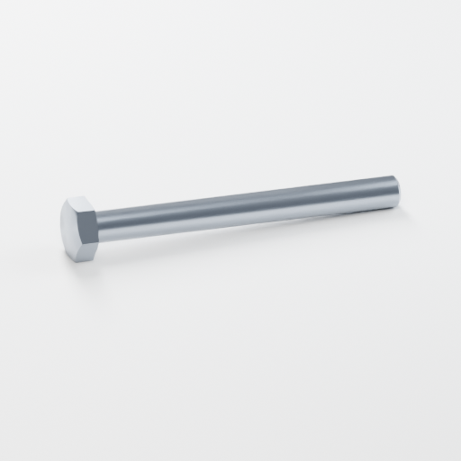

# OOMP version 5

## Summary

OOMP is a collection of reusable part records for electronics, hardware and mechanical projects. Each catalogue brings together part identifiers, structured metadata and available drawings, models or reference files. Start here to find the right repository, then choose an exact part in its catalogue.

Example: [M4 bolt, 40 mm long](https://github.com/oomlout/oomp_hardware_bolt_version_5/tree/main/parts/hardware_bolt_m4_40_mm_length/). This is a generated catalogue illustration, not a photograph or a dimensional specification.

## Details

Choose a full catalogue for source data and available assets, the visual browser for quick discovery, or a YAML export for lightweight data use. Files and completeness vary by repository.

Repositories checked on 2026-11-16. The list includes GitHub projects absent from this computer and preserves their published names.

### Part catalogues

| Repository | What it provides |
| --- | --- |
| [Bearings](https://github.com/oomlout/oomp_bearing_version_5) | Bearing catalogue project; GitHub reports 0 KiB and no root README was available at audit time. |
| [UK six-outlet extension lead](https://github.com/oomlout/oomp_electrical_extension_lead_uk_socket_6_outlet_pro_elec_2068_version_5) | Pro Elec 2068 extension-lead records and associated assets. |
| [Electronic breakouts](https://github.com/oomlout/oomp_electronic_breakout_version_5) | Breakout boards, pin layouts and mounting geometry. |
| [Electronic projects](https://github.com/oomlout/oomp_electronic_project_version_5) | Board projects, component matching, interactive explorers and production outputs. |
| [Electronic components](https://github.com/oomlout/oomp_electronic_version_5) | Component records, package drawings, KiCad assets and source metadata. |
| [Bolts, nuts and washers](https://github.com/oomlout/oomp_hardware_bolt_version_5) | Hardware variants, dimensional drawings, models and supplier records. |
| [Screws](https://github.com/oomlout/oomp_hardware_screw_version_5) | Screw families and sizes, drawings and generated models. |
| [Mechanical parts](https://github.com/oomlout/oomp_mechanical_version_5) | Shaft couplers, magnets and timing pulleys with models and drawings. |

### Browsers and lightweight exports

| Repository | What it provides |
| --- | --- |
| [Electronics visual browser](https://github.com/oomlout/oomp_electronic_verison_5_pretty) | A compact, illustrated electronics catalogue. The published name spells version as verison. |
| [Electronics YAML export](https://github.com/oomlout/oomp_electronic_version_5_only_yaml) | Lightweight metadata and thumbnails; GitHub reports 0 KiB and no root README was available at audit time. |
| [Bolts YAML export](https://github.com/oomlout/oomp_hardware_bolt_version_5_only_yaml) | Lightweight hardware metadata and thumbnails. |
| [Screws YAML export](https://github.com/oomlout/oomp_hardware_screw_version_5_only_yaml) | Lightweight screw metadata and thumbnails. |

### Shared tools

| Repository | What it provides |
| --- | --- |
| [OOMP core](https://github.com/oomlout/oomlout_oomp_version_5) | Shared identifiers, metadata and documentation utilities; this directory. |

## Using the catalogues

1. Open the repository for the component family you need.
2. Follow its catalogue or `parts/` folders to the exact variant.
3. Check the full OOMP ID and source metadata before using its available files. Model formats, drawings and supplier references vary by part.

For local setup and modifications, see the [generator guide](README_GENERATOR.md). Maintainers can use the [documentation standard and repository audit](presentation/README.md).
