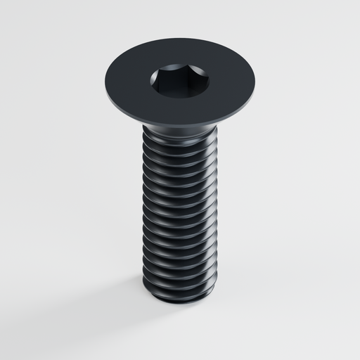
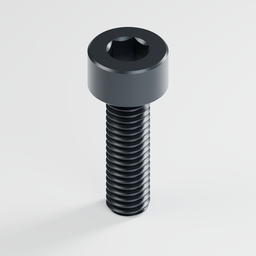
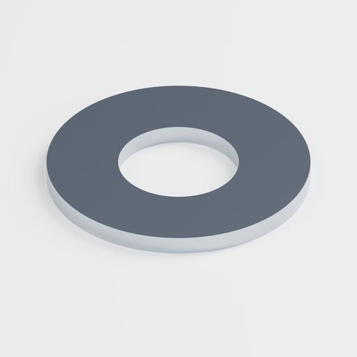
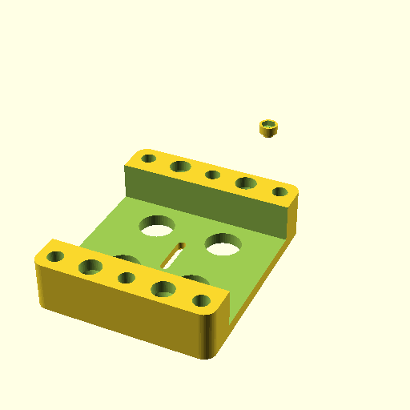

# OOMP version 5

## Summary

OOMP is a collection of reusable part records for electronics, hardware and mechanical projects. Each catalogue brings together part identifiers, structured metadata and available drawings, models or reference files. Start here to find the right repository, then choose an exact part in its catalogue.

| [M3 countersunk](https://github.com/oomlout/oomp_hardware_screw_version_5/tree/main/parts/hardware_screw_countersunk_hex_head_black_m3_diameter_10_mm_length/) | [M3 socket cap](https://github.com/oomlout/oomp_hardware_screw_version_5/tree/main/parts/hardware_screw_socket_cap_hex_head_black_m3_diameter_10_mm_length/) | [M3 nut](https://github.com/oomlout/oomp_hardware_bolt_version_5/tree/main/parts/hardware_nut_m3/) | [M3 washer](https://github.com/oomlout/oomp_hardware_bolt_version_5/tree/main/parts/hardware_washer_m3/) | [M6 × 25 set screw](https://github.com/oomlout/oomp_hardware_bolt_version_5/tree/main/parts/hardware_set_screw_m6_25_mm_length/) |
| --- | --- | --- | --- | --- |
|  |  |  |  |  |

Full-detail catalogue renders, reduced for this page. The two M3 screws are 10 mm long; the set screw is M6 × 25 mm with a fully threaded hex head. Click a name for its part record or an image for a larger preview. Illustrations are not to a common scale.

## Details

Choose a full catalogue for source data and available assets, the visual browser for quick discovery, or a YAML export for lightweight data use. Files and completeness vary by repository.

Repositories checked on 2026-11-16. The list includes GitHub projects absent from this computer and preserves their published names.

Main repositories are sorted by their full repository name/code. Alternative browsers and YAML-only exports are linked beneath their main repository.

| Repository | What it provides | Sample |
| --- | --- | --- |
| [oomlout_oomp_version_5](https://github.com/oomlout/oomlout_oomp_version_5) | **OOMP core.** Shared identifiers, metadata and documentation utilities; this directory. |  Example part record |
| [oomp_bearing_version_5](https://github.com/oomlout/oomp_bearing_version_5) | **Bearings.** Bearing catalogue project; GitHub reports 0 KiB and no root README was available at audit time. | No sample published yet. |
| [oomp_electrical_extension_lead_uk_socket_6_outlet_pro_elec_2068_version_5](https://github.com/oomlout/oomp_electrical_extension_lead_uk_socket_6_outlet_pro_elec_2068_version_5) | **UK six-outlet extension lead.** Pro Elec 2068 extension-lead records and associated assets. |  Extension-lead holder |
| [oomp_electronic_breakout_version_5](https://github.com/oomlout/oomp_electronic_breakout_version_5) | **Electronic breakouts.** Breakout boards, pin layouts and mounting geometry. |  Servo-tester mounting plate |
| [oomp_electronic_project_version_5](https://github.com/oomlout/oomp_electronic_project_version_5) | **Electronic projects.** Board projects, component matching, interactive explorers and production outputs. |  Adafruit PWM Servo Shield |
| [oomp_electronic_version_5](https://github.com/oomlout/oomp_electronic_version_5) Variants: [Visual browser](https://github.com/oomlout/oomp_electronic_verison_5_pretty) · [YAML only](https://github.com/oomlout/oomp_electronic_version_5_only_yaml) | **Electronic components.** Component records, package drawings, KiCad assets and source metadata. |  LMV321-TR pinout |
| [oomp_hardware_bolt_version_5](https://github.com/oomlout/oomp_hardware_bolt_version_5) Variants: [YAML only](https://github.com/oomlout/oomp_hardware_bolt_version_5_only_yaml) | **Bolts, nuts and washers.** Hardware variants, dimensional drawings, models and supplier records. |  M6 × 25 mm set screw |
| [oomp_hardware_screw_version_5](https://github.com/oomlout/oomp_hardware_screw_version_5) Variants: [YAML only](https://github.com/oomlout/oomp_hardware_screw_version_5_only_yaml) | **Screws.** Screw families and sizes, drawings and generated models. |  M3 × 10 mm socket cap |
| [oomp_mechanical_version_5](https://github.com/oomlout/oomp_mechanical_version_5) | **Mechanical parts.** Shaft couplers, magnets and timing pulleys with models and drawings. |  10 mm flange coupler |

## Using the catalogues

1. Open the repository for the component family you need.
2. Follow its catalogue or `parts/` folders to the exact variant.
3. Check the full OOMP ID and source metadata before using its available files. Model formats, drawings and supplier references vary by part.

For local setup and modifications, see the [generator guide](README_GENERATOR.md). Maintainers can use the [documentation standard and repository audit](presentation/README.md).
